# Installing ShapeBit

ShapeBit is a developer preview. Installing it **erases the whole disk** you
choose.

## What you need

- A 64-bit PC (x86-64) with UEFI, Secure Boot, and a TPM 2.0. Most PCs
  made since 2018 have them.
- A USB drive of at least 8 GB. Writing ShapeBit to it erases it.
- A disk for ShapeBit that holds nothing you want to keep.

## 1. Download

Download the installer, `installer.img.xz`. For now it comes from the latest
[Candidate run](https://github.com/shapebit-software/os/actions/workflows/candidate.yml):
open the run and download **installer** under *Artifacts*, which needs a
GitHub account. Unzip it. You don't need to decompress `installer.img.xz`:
the tools below read it as it is.

## 2. Write it to the USB drive

Use one of these free tools:

- **[balenaEtcher](https://etcher.balena.io)** (Windows, macOS, Linux):
  **Flash from file**, pick `installer.img.xz`, **Select target**, pick the
  USB drive, then **Flash!**
- **[Rufus](https://rufus.ie)** (Windows): pick the USB drive under
  *Device*, click **SELECT**, pick `installer.img.xz`, then **START**. Keep
  the settings Rufus chooses.

When it's done, Windows or macOS may say it can't read the drive and offer to
format it. Choose **Cancel**: formatting would erase the installer.

### Is there an ISO?

No. The installer is a disk image (`.img`), not an ISO, and you can't convert
it to one: renaming the file doesn't work. You don't need an ISO, because
Rufus and balenaEtcher write the disk image directly.

## 3. Prepare the PC

In the PC's firmware settings (often **F2**, **Del**, or **F10** at power-on):

- Leave **Secure Boot** on.
- If you see an option for Microsoft's **third-party UEFI certificate**
  ("Allow Microsoft 3rd Party UEFI CA"), turn it on. Some Windows PCs turn it
  off by default.
- Turn off **Legacy boot** (CSM) if it's there.

## 4. Boot the USB drive and accept ShapeBit's key

Plug in the drive and choose it in the PC's boot menu (often **F12**, **F11**,
**F8**, or **Esc** at power-on).

The first time on each PC, the startup stops at a blue screen, because the
PC doesn't know ShapeBit's key yet. You accept it once, and that PC trusts it
from then on. No password is needed. Use the arrow keys and **Enter**:

1. **Verification failed**: choose **OK**.

   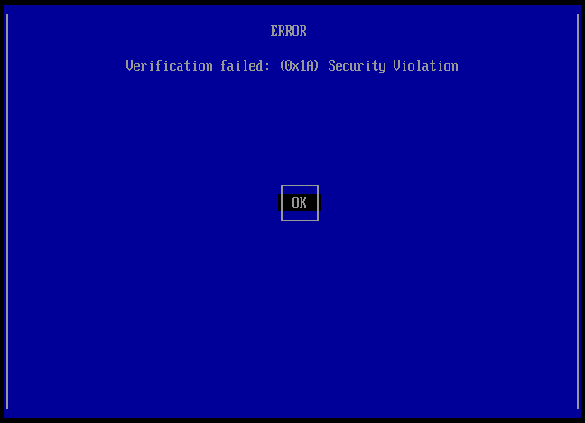

2. **Press any key to perform MOK management**: press a key within 10
   seconds. If you miss it, restart and boot the drive again.

   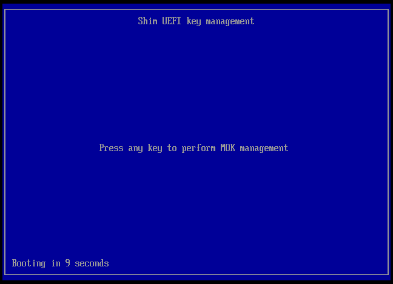

3. Choose **Enroll key from disk**.

   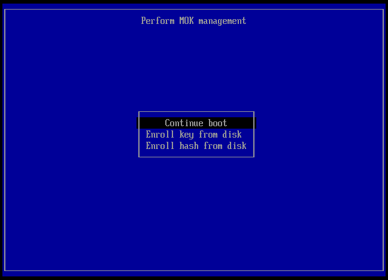

4. Choose the drive (**INSTALLER**), then **enroll-this-key.cer**.

   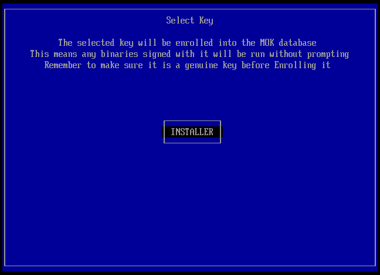
   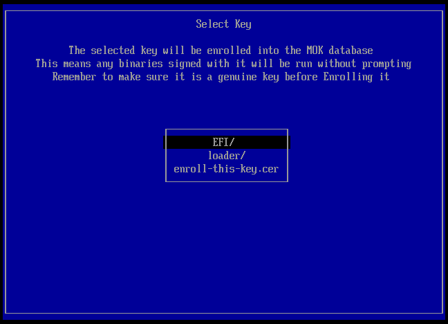

5. Choose **Continue**, then **Yes**.

   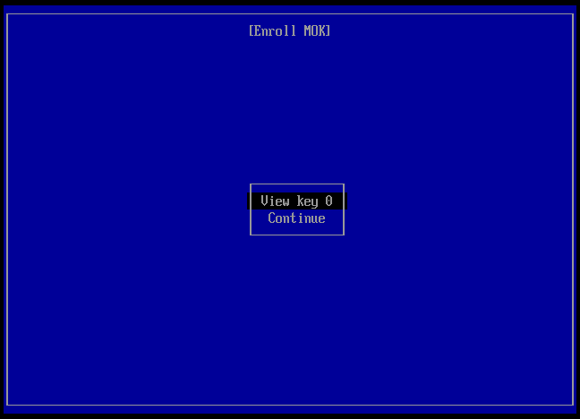
   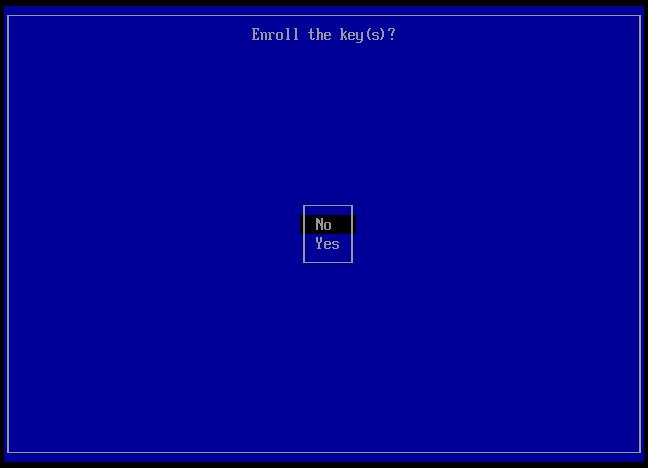

6. Choose **Reboot**. The PC starts the installer.

   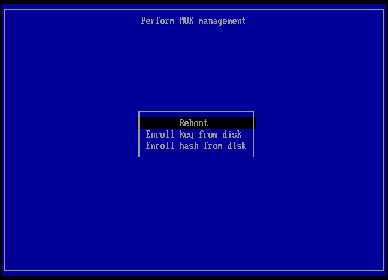

## 5. Install

The installer asks for your language, keyboard layout, network, time zone,
and account, then the disk.

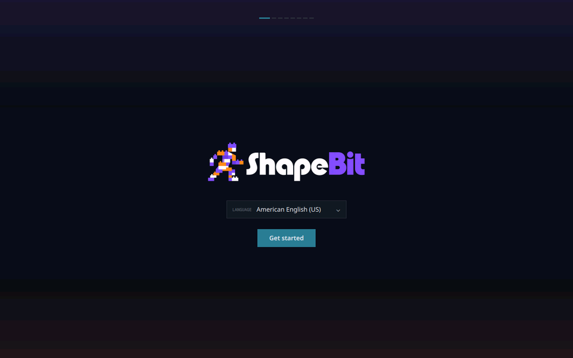

- **Network**: choose **Skip for now**. The installer can't connect to Wi-Fi
  yet, and it doesn't need the internet.

  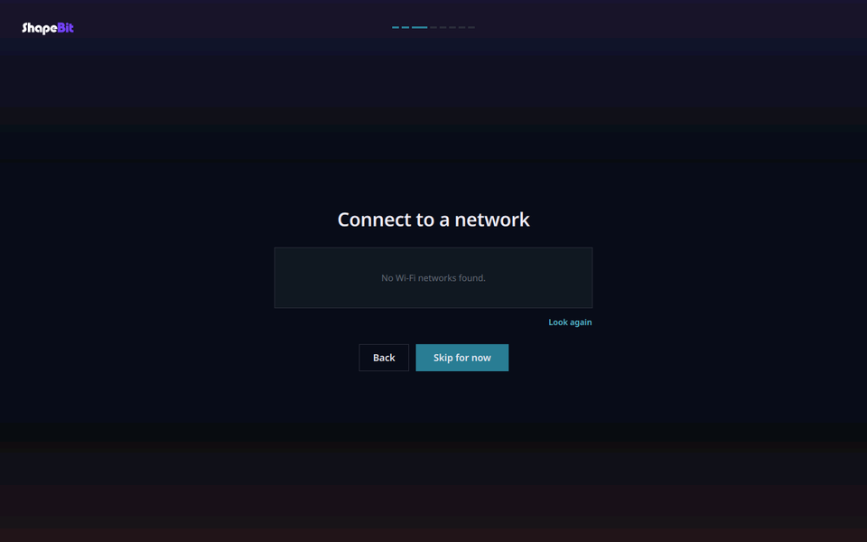

- **Account**: your name and password. The password unlocks your session
  and your files.

  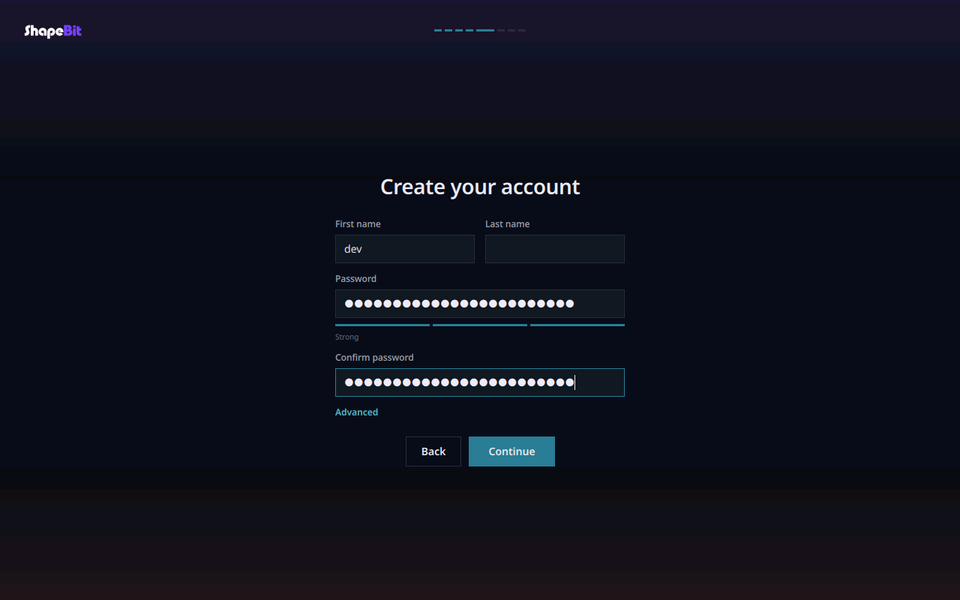

- **Disk**: pick the disk, tick the box that says all its data will be
  deleted, then **Erase disk and install ShapeBit**.

  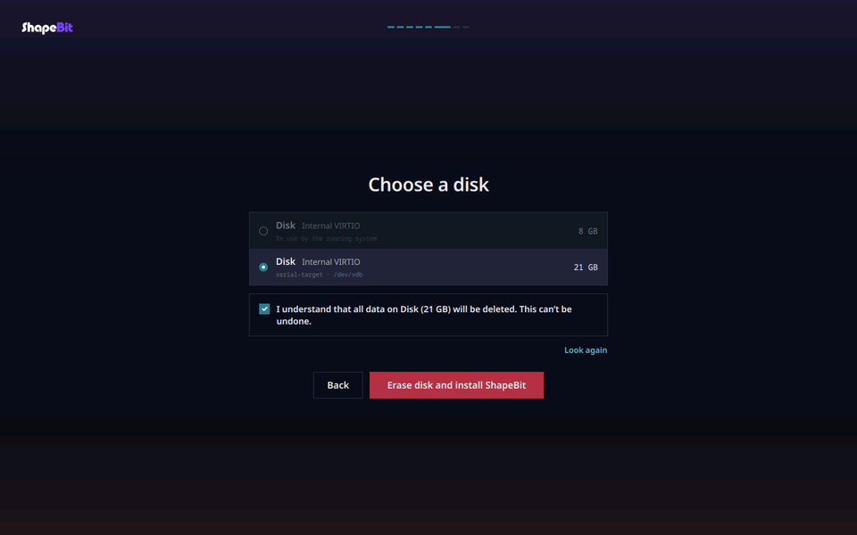

- **Recovery key**: write it down or photograph it, and keep it away from
  the PC. It's the only way in if the PC ever can't unlock its disk by
  itself, and it's never shown again.

  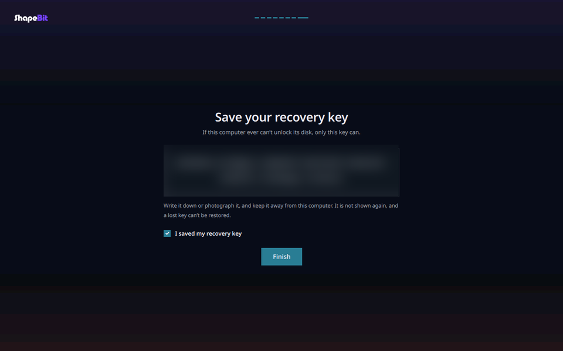

## 6. Start ShapeBit

Remove the USB drive and restart. The disk unlocks by itself, and the login
screen opens. After you sign in, **Welcome** connects you to the network and
offers a browser and apps.

If the PC ever asks for a passphrase at startup, type the recovery key
([Recovery](Architecture-Recovery.md)).
